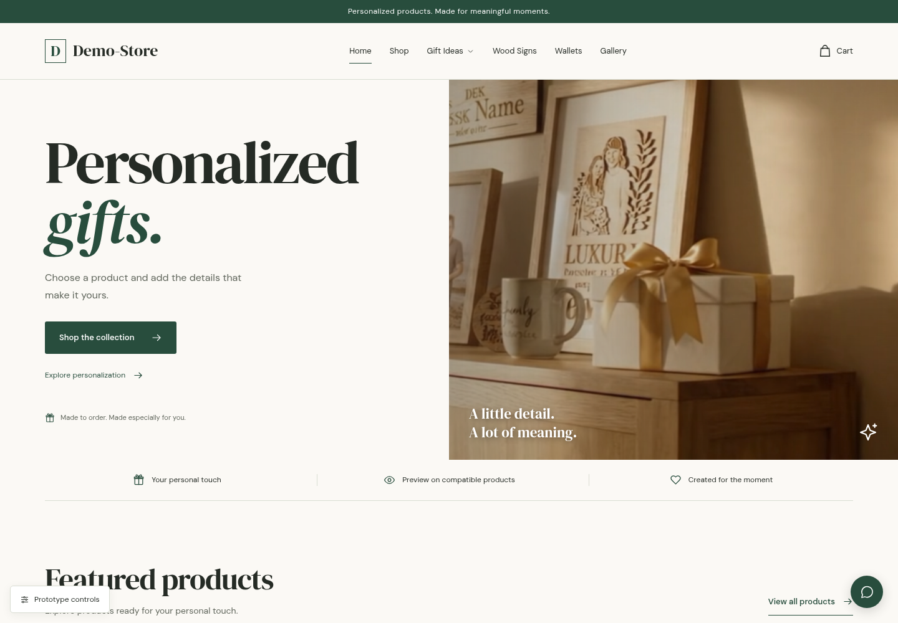
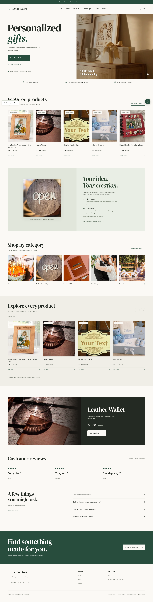
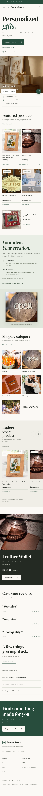

# Customelo homepage prototype

A standalone homepage design concept based on your uploaded storefront screenshots. This branch contains the prototype only; it does not deploy or connect to your live application.

## See the design

[View the complete desktop homepage](prototype/review/desktop.png) · [View the complete mobile homepage](prototype/review/mobile.png) · [Read the design evaluation](prototype/REVIEW.md)

Show the complete desktop design

Show the mobile design

## Open the interactive prototype

1. [Download this branch as a ZIP](https://github.com/ricorcio360/etts/archive/refs/heads/customelo-homepage-prototype.zip).
2. Extract the ZIP.
3. Open `prototype/standalone.html` in your usual desktop browser. It contains all images and fonts in one file. If your browser restricts local HTML, use the local-server instructions in [the project README](prototype/README.md).

Use **Prototype controls** to compare your original screenshots and try merchant names and colors. Menus, category browsing, product rail controls, FAQs and the screenshot comparison work. Product, cart, checkout, chat, gallery and AI services are outside this homepage prototype.

Validated over HTTP at 1440px, 390px and 320px, with no page overflow, JavaScript errors or external browser requests. Source photography comes from screenshot viewports, so image resolution is limited. Original screenshots at the repository root remain unchanged.
